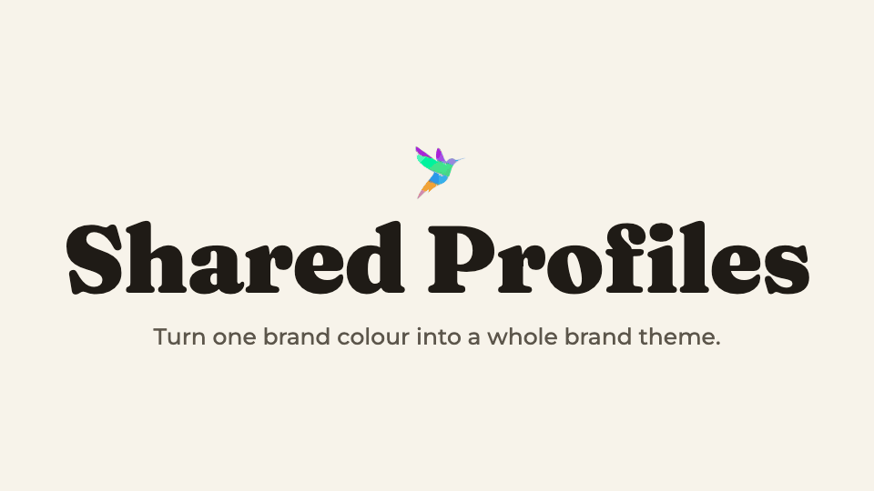

# IndieOps Shared Profiles

**Type a fact once. Every IndieOps Skilllet knows it.**

*Skilllet. Fine-tuned Agentic superpowers.* · Skilllet 2026-15 · [indieops.co](https://indieops.co)

**Runs on** macOS 10.15+ · Windows 10+ · Linux  
**Works with** Claude  
**Needs** Node.js 18+ for the helper script and brand themes (optional) · an internet connection to import a theme

<picture>
  <source media="(prefers-color-scheme: dark)" srcset="docs/demo-dark.gif">
  
</picture>

LinkPanther learns the domain. GBPCoach learns the business. Instantly Ready learns the sending
setup. Right now each one asks you from scratch. Install this and they stop.

And now it knows how you *look*: give yourself, or any client, a brand theme — colours, fonts, type,
corners, logo — in one file that any Skilllet that makes reports, posts or pages can wear.

Free, and it makes every other Skilllet you own better.

---

## What it is

One folder on your machine, in plain Markdown:

```
~/.indieops/
├── me.md                           *you* — name, voice, brand defaults
├── brand/                          your brand theme (optional)
└── businesses/
    └── acme-plumbing/
        ├── profile.md              *business* — services, domains, DNS, areas
        ├── brand/                  this business's brand theme (optional)
        └── notes/
            ├── gbpcoach.md         each Skilllet's own notes - auto-generated as needed.
            └── linkpanther.md
```

Two roots, because your Skilllets split two ways. TastePilot and the course builder care who *you*
are and don't care about any client. GBPCoach and LinkPanther care about a *business*. Both read what
they need and ignore the rest.

No database, no server, nothing to install. You can open any of these files, read them, fix a typo,
diff them in git, or email one to an assistant.

---

## Brand themes

A theme is everything about how you, or a client, look: colours for every role (accent, background,
text, lines…), fonts, type sizes, corners, spacing, components, and a short list of do's and don'ts.

You don't start from a blank page. You pick a design language from
**[awesome-design-md](https://github.com/VoltAgent/awesome-design-md)** — VoltAgent's open collection
of DESIGN.md files describing 80-odd well-known products — and make it yours: your colour, your fonts,
your logo. Those changes are kept separately, so you can switch to a different starting design later
and keep them.

Then open `brand/preview.html`. It shows your brand on a spec sheet, social posts, a landing page, a
report and an email header, in light and dark, with a control for everything. Change what you like,
press **Copy edits**, paste it to Claude, and it's applied.

Or just say *"give Acme Plumbing a brand theme"*. Claude shows you a shortlist that fits, imports the
one you pick, asks for your colour and logo, and opens the preview.

```
node scripts/ioc.mjs theme catalog                          the designs to start from
node scripts/ioc.mjs theme import stripe --business acme    start from one
node scripts/ioc.mjs theme set --business acme accent "#0a7c66" fonts.display Fraunces
node scripts/ioc.mjs theme build --business acme --open     open the live preview
node scripts/ioc.mjs theme apply-edits - --business acme    apply edits pasted from the preview
```

Every creative is made with *your* name and logo — the design you started from is a starting point,
never a brand you borrow. Dark mode is worked out for you with readable contrast, and up/down colours in
reports never take your brand colour. Each imported design keeps its MIT licence in
`brand/SOURCE-LICENSE.txt`.

---

## Install

Drop the `shared-profiles` folder in as a skill, the same as any other Skilllet, then:

```
node scripts/ioc.mjs init --business "Acme Plumbing"
```

Or just say *"set up my shared profiles"* and let the Skilllet do it.

Then fill in `me.md`. The voice section is the one that pays for itself — it's why the next thing you
generate sounds like you wrote it.

---

## Commands

```
node scripts/ioc.mjs where        where the library resolved to
node scripts/ioc.mjs init         create it
node scripts/ioc.mjs add "Name"   add a business
node scripts/ioc.mjs list         every business, when you last touched it, which Skilllets ran
node scripts/ioc.mjs show <slug>  print a profile
node scripts/ioc.mjs theme …      brand themes (node scripts/ioc.mjs theme --help)
```

`list` answers the question a freelancer actually has:

```
  BUSINESS                 LAST UPDATED     THEME   SKILLLETS USED
  testville-family-dental  today            Claude  gbpcoach
  acme-plumbing-heating    23 days ago      —       gbpcoach, linkpanther
```

---

## Where it lives, and moving it

First match wins:

1. `$INDIEOPS_HOME`
2. a path in a `.indieops-home` file in the folder you're working in
3. `~/.indieops`

Want it in Dropbox, iCloud or a git repo? Set `INDIEOPS_HOME` and it moves. A git repo is a genuinely
good home for it — Markdown diffs beautifully, so you get a history of every client fact that ever
changed, which is not something a database gives you for free.

---

## No secrets in here

API keys, passwords, tokens, portal logins — none of it. Those belong in environment variables. This
is plain text in a home directory and it will end up in a backup, a screen share or a sync folder
sooner or later. Every Skilllet that uses this library is instructed the same way.

---

## Adding it to your own Skilllet

`CONVENTION.md` is the whole spec, and the integration is nine lines of Markdown in your `SKILL.md`
(plus one more paragraph if your Skilllet renders anything and should wear the brand theme).
The four rules that matter:

1. **Read before you ask.** If it's in the library, don't ask for it again.
2. **Add missing facts. Never overwrite one another Skilllet set** — flag the conflict and let the
   user decide.
3. **Your own findings go in `notes/<your-skill>.md`.** Nothing else writes there, so nothing collides.
4. **Never require it.** A missing library is not an error. Check, use it if it's there, carry on
   quietly if it isn't.

---

## Why not a database

Because an agent can read a Markdown file with no tool and no library, and a database needs a script
invocation every single time. Because you can open, read, fix and diff Markdown, and a `.db` file is
a black box you can't inspect and can't repair. And because Markdown works in any agent, on any OS,
with nothing installed — which is the entire point of a Skilllet.

If you ever want cross-business queries, build an index *from* these files and treat it as a
disposable cache. The Markdown stays the source of truth.

---

v1.1 · October 2026 · IndieOps Free License · Built by [IndieOps](https://indieops.co)

**More Skilllets and plugins:** [indieops.co/skills-and-plugins](https://indieops.co/skills-and-plugins) · **Questions?** [support@indieops.co](mailto:support@indieops.co)

## License

Copyright © 2026 IndieOps. All rights reserved.  
Licensed under the [IndieOps Free License v1.0](LICENSE). Free to use, even commercially; don't redistribute it.
